# Malvex Architecture

Evidence-driven malware analysis harness. The objective is not report generation — it is
verified, evidence-backed investigation of malware behavior, capabilities, and lineage.

## System diagram

```mermaid
graph TD
    subgraph "Entry Points"
        CLI["sasf-cli<br/>malvex binary<br/>12 subcommands"]
        WEB["sasf-web<br/>axum upload UI<br/>drag binary → identify → run"]
        MCP_SERVER["MCP server<br/>malvex serve --mcp<br/>JSON-RPC 2.0 over stdio<br/>8 tools"]
    end

    subgraph "Orchestrator (sasf-orchestrator)"
        CONFIG["Config<br/>model, runtime, parallel,<br/>stages, approval mode"]
        PLAN["plan()<br/>stage graph + agent sharding"]
        EXEC["exec.rs<br/>run_real, resume,<br/>per-agent output capture"]
        PARSE["parse.rs<br/>lenient Finding extraction<br/>from LLM stdout"]
        TAXONOMY["taxonomy.rs + chains.rs<br/>vector ownership,<br/>attack-chain library"]
        SKILLGEN["skillgen.rs<br/>gap → new SKILL.md"]
        EXTRACT["extract.rs<br/>MSI/CAB/NSIS/.app/.dmg<br/>unpack"]
        POC["pocrun.rs + pocval.rs<br/>PoC generation,<br/>compile-validation"]
    end

    subgraph "Provider Layer"
        CLAUDE["Claude Code CLI<br/>claude -p --dangerously-skip-permissions<br/>--model --fallback-model<br/>--append-system-prompt-file"]
        CODEX["Codex CLI<br/>codex exec --ephemeral<br/>MALVEX_MODEL_HINT"]
        CUSTOM["Custom wrapper<br/>MALVEX_CUSTOM_CMD<br/>MALVEX_PROMPT / MALVEX_MODEL"]
        HERMES["Hermes CLI<br/>deepseek/qwen/kimi/glm/grok<br/>--hermes-provider --hermes-model<br/>fallback on rate limit"]
        OLLAMA["Ollama<br/>local LLM, offline,<br/>air-gapped labs<br/>MALVEX_OLLAMA_MODEL"]
    end

    subgraph "Agents (agents/*.md)"
        TRIAGE["triage<br/>hashes, type, arch, packer,<br/>entropy, strings, IOCs"]
        STATIC["static-core<br/>headers, resources, manifests,<br/>compiler fingerprinting"]
        DECOMP["decompilation<br/>function recovery, CFG,<br/>xrefs, renaming"]
        DEOBF["deobfuscation<br/>OEP, unpacking, string crypto,<br/>API hashing, staged loaders"]
        DYNAMIC["dynamic-analysis<br/>process tree, persistence,<br/>C2, exfiltration"]
        MEMORY["memory-analysis<br/>injections, RWX, hollowing,<br/>config in memory"]
        NETWORK_A["network-analysis<br/>pcap, C2 beaconing, DGA,<br/>TLS fingerprints, protocol"]
        DETECT["detection-engineering<br/>YARA, Sigma, EDR logic"]
        INTEL["threat-intel<br/>family, overlap, lineage"]
        VALID["validator<br/>reject unsupported claims,<br/>enforce evidence"]
        FIRMWARE["firmware-analysis<br/>extraction, region analysis,<br/>embedded FS carving"]
        MOBILE["mobile-analysis<br/>APK/DEX, manifest, native libs,<br/>permission audit"]
        SANDBOX["sandbox-analysis<br/>detonation, behavioral traces,<br/>evasion detection"]
    end

    subgraph "Tool Layer (sasf-doctor)"
        REGISTRY["registry.rs<br/>216 tools with probes,<br/>install commands, MCP mapping"]
        MCP_SETUP["mcp.rs<br/>18 MCP servers<br/>auto-register with claude"]
        SCAN["scan()<br/>probe PATH + python imports<br/>+ configured MCPs"]
    end

    subgraph "REA Layer (auto-installed)"
        REA["REA MCP Server<br/>npx rea<br/>unified RE interface"]
        REA_GHIDRA["Ghidra provider"]
        REA_IDA["IDA provider"]
        REA_R2["radare2 provider"]
        REA_FRIDA["Frida provider"]
        REA_DOTNET[".NET provider"]
        REA_ANDROID["Android provider"]
        REA_BROWSER["Browser/Electron provider"]
    end

    subgraph "Analysis Tools"
        IDA["IDA Pro<br/>idalib MCP"]
        GHIDRA["Ghidra<br/>analyzeHeadless + MCP"]
        R2["radare2<br/>CLI + MCP"]
        FRIDA["Frida<br/>hooking + MCP"]
        YARA["YARA<br/>yaraflux MCP"]
        NATIVE["readelf / objdump / otool / nm<br/>strings / floss / capa"]
        DEBUG["gdb / lldb / x64dbg / WinDbg"]
        NET["tshark / tcpdump / mitmproxy"]
        CARVE["binwalk / 7z / msitools<br/>foremost / bulk_extractor"]
        MEMORY_T["volatility3"]
    end

    subgraph "Evidence Layer"
        FINDINGS["findings.json<br/>Finding[] with evidence,<br/>severity, verdict, locus"]
        SESSION["sessions/&lt;id&gt;/<br/>target.json, session.log,<br/>raw agent output"]
        GRAPH["attack-graph.md + .json<br/>mermaid flowchart<br/>chained exploitation paths"]
        SUMMARY["summary.md<br/>severity tally + listing"]
    end

    CLI --> CONFIG
    WEB --> CONFIG
    MCP_SERVER --> CONFIG
    CONFIG --> PLAN
    PLAN --> EXEC
    EXEC --> CLAUDE
    EXEC --> CODEX
    EXEC --> CUSTOM
    EXEC --> HERMES
    EXEC --> OLLAMA
    EXEC --> PARSE
    PARSE --> FINDINGS
    TAXONOMY --> PLAN

    CLAUDE --> TRIAGE
    CLAUDE --> STATIC
    CLAUDE --> DECOMP
    CLAUDE --> DEOBF
    CLAUDE --> DYNAMIC
    CLAUDE --> MEMORY
    CLAUDE --> DETECT
    CLAUDE --> INTEL
    CLAUDE --> VALID
    CLAUDE --> NETWORK_A
    CLAUDE --> FIRMWARE
    CLAUDE --> MOBILE
    CLAUDE --> SANDBOX

    TRIAGE --> IDA
    TRIAGE --> NATIVE
    STATIC --> IDA
    STATIC --> GHIDRA
    DECOMP --> IDA
    DECOMP --> GHIDRA
    DECOMP --> R2
    DEOBF --> IDA
    DEOBF --> R2
    DYNAMIC --> FRIDA
    DYNAMIC --> DEBUG
    DYNAMIC --> NET
    MEMORY --> MEMORY_T
    DETECT --> YARA
    INTEL --> NATIVE
    NETWORK_A --> NET
    FIRMWARE --> CARVE
    MOBILE --> NATIVE
    SANDBOX --> DYNAMIC

    REGISTRY --> SCAN
    MCP_SETUP --> IDA
    MCP_SETUP --> GHIDRA
    MCP_SETUP --> R2
    MCP_SETUP --> FRIDA
    MCP_SETUP --> YARA
    MCP_SETUP --> REA

    REA --> REA_GHIDRA
    REA --> REA_IDA
    REA --> REA_R2
    REA --> REA_FRIDA
    REA --> REA_DOTNET
    REA --> REA_ANDROID
    REA --> REA_BROWSER
    REA_GHIDRA --> GHIDRA
    REA_IDA --> IDA
    REA_R2 --> R2
    REA_FRIDA --> FRIDA

    TRIAGE --> REA
    DECOMP --> REA
    STATIC --> REA
    MOBILE --> REA

    EXEC --> SESSION
    EXEC --> GRAPH
    EXEC --> SUMMARY
    EXTRACT --> EXEC
    POC --> EXEC
    SKILLGEN --> TAXONOMY
```



## Pipeline

```text
upload/path
  → triage
  → static-core ∥ decompilation ∥ deobfuscation   (sharded with -j N)
  → dynamic-analysis ∥ memory-analysis             (gate: host must match target platform)
  → network-analysis                               (tshark/tcpdump/mitmproxy/zeek)
  → detection-engineering ∥ threat-intel
  → validator
  → session artifacts (findings.json, summary.md, attack-graph)
```

Each stage waits for the prior stage to complete. Within a stage, agents run in parallel
(native threads via `std::process::Command`). Sharding (`-j N`) splits taxonomy vectors
across N copies of each agent: shard 1 gets vectors 0, N, 2N; shard 2 gets 1, N+1, 2N+1.

## Agent roles

| Agent | Responsibility |
|---|---|
| `triage` | Hashes, real type, architecture, format, signatures, entropy, sections, imports, strings, initial IOCs. First pass — everything else builds on this. |
| `static-core` | Headers, resources, manifests, embedded config, compiler/runtime/framework fingerprinting. |
| `decompilation` | Function recovery, call graph, CFG, xrefs, function renaming, behavior reconstruction from pseudocode. |
| `deobfuscation` | Packers, OEP recovery, string/API decryption, control-flow flattening, anti-analysis, staged loaders. |
| `dynamic-analysis` | Debugging plan, process tree, persistence, discovery, C2, exfiltration, privilege behavior. Runtime evidence only when host matches target. |
| `memory-analysis` | Injections, RWX regions, manual mapping, reflective loading, decrypted strings, config in memory. |
| `detection-engineering` | YARA rules, Sigma rules, EDR logic, network and memory detection ideas. Each detection cites the proving artifact. |
| `threat-intel` | Family hypotheses, overlap, variant comparison, lineage. Similarity is not attribution. |
| `validator` | Rejects unsupported conclusions. Forces evidence/confidence normalization. Promotes plausible → confirmed only with independent reproduction. |
| `network-analysis` | Packet capture, C2 beaconing, DGA detection, TLS fingerprints, protocol dissection via tshark/tcpdump/mitmproxy/zeek. |
| `firmware-analysis` | Binary extraction, region analysis, embedded filesystem carving, firmware reverse engineering. |
| `mobile-analysis` | APK/DEX decompilation, manifest analysis, native lib extraction, permission audit. |
| `sandbox-analysis` | Automated detonation, behavioral trace collection, sandbox evasion detection. |

## Evidence contract

Every conclusion must point to one or more of:

- File offsets, RVA / VA, section names and entropy
- Import/export symbols, strings and decoded strings
- Disassembly or pseudocode loci with xrefs and graph relationships
- Debugger traces, memory artifacts (RWX, injected regions)
- Files, registry keys, services, tasks, pipes, mutexes
- DNS / HTTP / TLS observations, packet captures
- Generated detections (YARA/Sigma rules that compile and match)

**Evidence includes limitations.** When analysis cannot proceed (tool missing, platform
mismatch, encrypted section), the finding states what is unknown and why, rather than
masking incomplete data.

## Provider architecture

The `Config` struct holds: model, fallbacks, runtime backend, parallel count, approval mode,
stage filter, custom prompt. `build_command()` translates Config into a concrete
`std::process::Command` for the selected runtime:

- **claude**: `claude -p <prompt> --model <model> --fallback-model <fallbacks> --dangerously-skip-permissions --append-system-prompt-file agents/<role>.md --add-dir <root> --output-format json`
- **codex**: `codex exec --skip-git-repo-check --ephemeral <merged-prompt>` with `MALVEX_MODEL_HINT`
- **custom**: `eval "$MALVEX_CUSTOM_CMD"` with `MALVEX_PROMPT`, `MALVEX_MODEL`, `MALVEX_FALLBACKS`, `MALVEX_AGENT`, `MALVEX_ROOT`
- **hermes**: `hermes-cli --provider <hermes-provider> --model <hermes-model> <merged-prompt>` with fallback on rate limit
- **ollama**: `ollama run $MALVEX_OLLAMA_MODEL <merged-prompt>` for offline/air-gapped analysis

The provider is replaceable. The session model and evidence model are not.

## MCP strategy

Malvex **reuses MCPs already registered in the local `claude`** and can **auto-install more**
via `malvex mcp-setup`. MCP servers supported include ida-pro-mcp, ghidra-mcp,
radare2-mcp, frida-mcp, x64dbg-mcp, re-mcp, binaryninja-mcp, cutter-mcp, yaraflux-mcp,
and **rea** (the REA unified RE server).
Each is wired with `claude mcp add`, idempotent, commercial backends behind `--commercial`.

At agent invocation time, `detect_re_tools()` probes PATH and MCP config to build a
directive telling each agent which tools are available and in what priority order.

## REA layer

[REA](https://github.com/morluto/rea) is automatically installed during `malvex setup` and
registered as an MCP server. It provides a unified interface to Ghidra, IDA, radare2, Frida,
.NET decompilation, Android APK analysis, and browser/Electron inspection — all through one
MCP connection.

Malvex agents prefer REA's unified interface when available: disassembly, decompilation,
function listing, string extraction, xref analysis, and Frida hooking route through REA
instead of calling individual tool CLIs directly. This gives agents a consistent API
regardless of which RE tool is installed on the host.

Malvex adds capabilities REA does not cover: YARA/Sigma detection engineering, Volatility3
memory forensics, sandbox coordination (CAPE/Cuckoo), threat intelligence (MISP, VirusTotal,
MalwareBazaar), and the evidence-driven malware analysis pipeline with 15 specialized agents.
The two layers compose: REA handles RE primitives, Malvex orchestrates them for malware
investigation.

## Tool priority

```
IDA > Ghidra > Binary Ninja > radare2/rizin > format-native tooling
```

For dynamic work: Frida + platform-native debuggers (lldb on macOS, gdb on Linux,
x64dbg/WinDbg on Windows). Network: tshark/tcpdump/mitmproxy. Memory: volatility3.

## Execution model

Malvex operates **headless-first**:

- Prefer `idat`/`idat64`, `analyzeHeadless`, RE MCP backends, `radare2`/`rizin` CLI, and
  format-native tooling (otool/readelf/objdump/strings) for agentic runs.
- Treat GUI tools as optional analyst surfaces for annotation, visual graphing, or manual
  debugging.
- Keep session artifacts stable whether the work ran in a local shell, remote sandbox, CI
  job, Kali box, or subscription-backed agent runtime.

## Session model

```
sessions/<epoch>/
  target.json              identified target (hashes, format, shielding, bundle binaries)
  session.log              structured log with timestamp of every event
  findings.json            accumulated findings (source of truth)
  summary.md               severity tally + finding list
  <stage>-<agent>.out.json raw stdout of each agent (for reparse without LLM)
  attack-graph.md / .json  chained exploitation paths (mermaid)
```

- **Resume**: `malvex run --resume sessions/<id>` skips completed agents. An agent is "done"
  only if its output has no error marker (rate limit, crash, empty).
- **Reparse**: `malvex reparse sessions/<id>` re-derives findings from raw output with the
  current parser — no LLM call, no token spend.

## Sharding

`malvex run -j 3` creates 3 shards of each static agent. Agent `static-core.1` gets
vectors 0, 3, 6, …; `static-core.2` gets 1, 4, 7, …; `static-core.3` gets 2, 5, 8, ….
Each shard runs as an independent process. Findings merge in `parse.rs`.

## Design principles

1. **Design around the analyst question.** Tools and agents serve the investigation, not the
   other way around. The pipeline answers: what is it, what does it do, how does it do it,
   what does it target, how does it persist, how does it evade, where does it communicate,
   what is the impact, how can we detect it, and what evidence proves each conclusion.

2. **Local-only analysis.** Samples never leave the analyst's host. No cloud uploads, no
   telemetry, no external API calls with sample data. MCP servers run locally.

3. **Evidence includes limitations.** When a tool is missing or a platform mismatch prevents
   runtime analysis, the result says so explicitly. A gap is reported honestly, never filled
   with fabricated evidence.

4. **Graceful degradation.** A missing tool degrades the stage, never kills the session. IDA
   absent → fall back to Ghidra → fall back to radare2 → format-native. Every path produces
   evidence at some level.

5. **LLM output is not evidence.** The model proposes hypotheses, likely function names,
   algorithm matches, and ATT&CK mappings. These are analyst leads until tied to static or
   runtime evidence.

6. **Never fabricate a verifiable fact.** Hash, IOC, address, pseudocode excerpt, CVE: either
   it came from a real, checkable source, or it does not enter the findings.

7. **Failure ≠ negative result.** A tool crash, timeout, or parse error cannot silently
   become "nothing found". Technical failures are logged separately from honest negative
   results.
